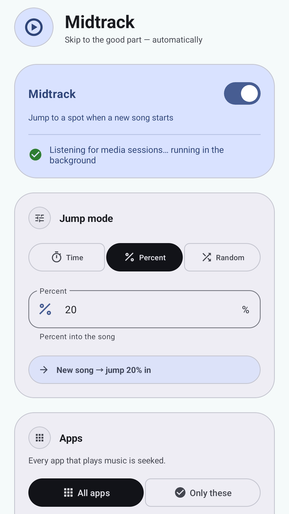
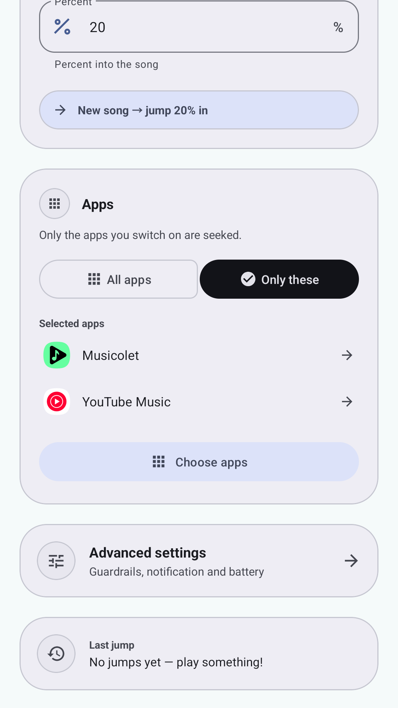
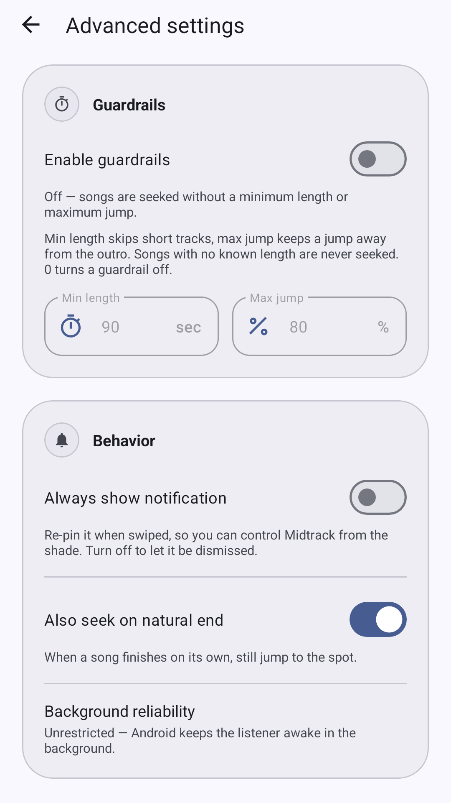

# Midtrack

**Skip to the good part — automatically.**

Midtrack is an Android app that jumps to a chosen spot every time a new song
starts. It works with the music player you already use — YouTube Music, YouTube,
Spotify, Musicolet, a local player, or any app that works with Android's playback
controls.

No ads, no account, no internet permission, no tracking. Everything stays on
your phone.

**Download:** [latest APK](https://github.com/xaepudin/midtrack/releases/latest) ·
[Privacy](PRIVACY.md) · [Issues](https://github.com/xaepudin/midtrack/issues)

  
  
  

## What it does

- Jumps to a **time** (`1:00`), a **percentage** of the song (`20%`), or a
  **random spot** (`15–60%`) whenever a new song starts.
- Optional **guardrails** can skip short tracks and keep a jump away from the
  outro. They are off by default.
- **Per-app rules** let YouTube Music jump 20% in while YouTube jumps to 0:15.
- Seek in **every app**, or only in the apps you choose. With **Only these**, the
  selected apps are shown on the main screen.
- Control it from the **notification** or the **Quick Settings** tile, including
  **Jump now** for the song already playing.
- English-only UI, light and dark themes.

## Install

Midtrack is not on the Play Store yet. Download the APK from
[Releases](https://github.com/xaepudin/midtrack/releases/latest).

1. Open the APK and allow your browser or file manager to install unknown apps
   when Android asks.
2. Open **Midtrack** and follow the setup checklist: notification access,
   notifications, and battery reliability. It ends with a test jump.
3. Play a song in your music app. The first song plays normally; the next one
   is jumped automatically.

Android 8.0 or newer is required.

## First run

The setup checklist explains each item and links straight to the right Android
screen:

- **Notification access** — needed so Midtrack can see the active media session.
  It reads only the song title, duration and playback position; it never reads
  your notification content.
- **Notifications** — shows the playback controls.
- **Background reliability** — ask Android not to put the listener to sleep.
- **Test current song** — confirms the jump on whatever is playing.

You can reopen the checklist later from **Advanced settings**.

## Choose your apps

By default Midtrack jumps in every app that plays music.

- Switch to **Only these** to choose specific apps. The selected apps appear on
  the main screen.
- Use the search, star and **Select all / Clear all** controls in the app list.
- Tap the sliders button on any app to give it its own jump rule.
- Generic audio handlers stay behind **Show all apps**.

## Keeping it reliable

Android may stop background listeners when the screen is off. If jumps stop
after a while, open **Advanced settings → Open battery settings**, select
**Midtrack**, and choose **Unrestricted**.

A health card on the main screen points out missing access, notifications or
battery settings whenever something needs attention.

## Troubleshooting

**Nothing happens on the next song.**

Check that notification access is granted, and that you have moved to a new song.
The first song plays normally and is not jumped.

**A short track was skipped.**

Guardrails are off by default, but if you enabled them, raise the minimum length
or set it to `0`.

**A live stream or ad was not seeked.**

Tracks with no known duration are never seeked; there is no safe spot to choose.

**The notification disappeared.**

**Always show notification** is off by default. Enable it in Advanced settings
to make the notification ongoing and re-pin it after a swipe.

**Only these does nothing.**

Open the app list and switch on at least one app. With nothing selected, nothing
is seeked.

**My player is not listed.**

It needs to work with Android's playback controls. Turn on **Show all apps** in
the app list; if it still does not appear, play something in it once and reopen
the list.

## Privacy

Midtrack has **no internet permission**, no ads, no analytics and no account.
Notification access is used only to inspect the active media session. Settings
and the last jump stay on the device and are excluded from backups.

Read the [privacy policy](PRIVACY.md) for details.

## License

Midtrack is free software under the **GNU General Public License v3.0**. See
[LICENSE](LICENSE). Midtrack is not affiliated with Google, YouTube, YouTube
Music, Spotify, or any other music service.

## For developers

Build, test and release notes are in [docs/development.md](docs/development.md),
[docs/architecture.md](docs/architecture.md) and
[docs/releasing.md](docs/releasing.md).
