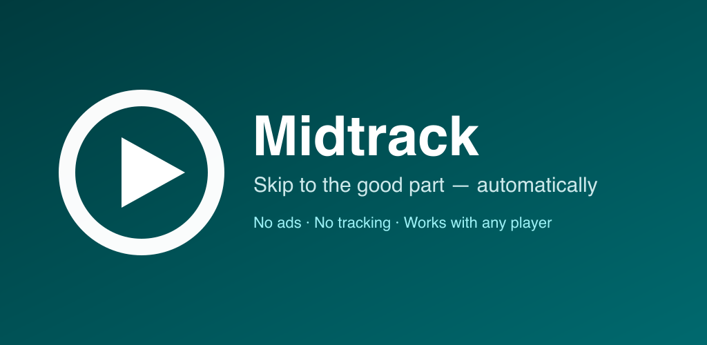

# Midtrack

[](https://github.com/xaepudin/midtrack/actions/workflows/ci.yml)
[](LICENSE)
[](https://github.com/xaepudin/midtrack/actions/workflows/release.yml)

**Skip to the good part — automatically.**

Midtrack is an Android app that jumps to the spot you choose every time a
new song starts. It works with the player you already use — YouTube Music,
YouTube, Spotify, Musicolet, a local player, or anything else that publishes a
media session.

No ads, no account, no internet permission, no tracking. Everything happens on
your phone.

<p align="center">
  
</p>

<p align="center">
  
  
  
</p>

## Why

Some songs have a long intro. Some albums put the good part at 0:40, some at
20%, and some at a random spot that keeps a playlist interesting. Midtrack
does that one thing, with optional guardrails so a jump never ruins a track.

## Features

- **Guided setup** — a first-run checklist for notification access, notifications,
  battery reliability and a test jump. If something breaks later, a health card
  on the main screen says what needs fixing.
- **Focused main screen** — the switch, jump mode, app scope and last jump. With
  **Only these**, the selected apps are listed on the main screen as a compact
  summary; the full picker and advanced options each have their own screen, so
  the main screen is not a wall of settings.
- **Three jump modes** — a fixed time (`1:00`), a percentage of the song
  (`20%`), or a random spot between two percentages (`15–60%`).
- **Optional guardrails** — off by default. Turn them on in **Advanced
  settings** to skip tracks shorter than a minimum length and to never jump
  past a maximum point, so a 60-second jump in a two-minute song cannot land
  you at the outro. Both limits can also be set to `0`.
- **Per-app rules** — YouTube Music can jump 20% in, YouTube can jump to 0:15,
  and a podcast app can be left alone. A rule only decides *where* to jump;
  the master switch still decides *whether* to jump at all.
- **Clean app picker** — real players and apps seen before are listed by
  default, with search, pinning, select-all and clear-all. Generic audio
  handlers stay behind **Show all apps**.
- **Whitelist or every app** — seek in every player, or only in the apps you
  choose. Choosing **Only these** takes you to the app list and shows the
  selected apps on the main screen; nothing selected means nothing is seeked,
  and the app says so.
- **Notification controls** — turn Midtrack on or off, cycle the jump mode,
  or apply the rule to the song already playing with **Jump now**. The ongoing
  notification is shown while the service runs and is dismissible by default;
  enable **Always show notification** in Advanced settings to make it ongoing
  and re-pin it after a swipe.
- **Quick Settings tile** — on/off from the shade, with the current rule in the
  subtitle.
- **English-only UI**, with light and dark themes and Material You dynamic
  colors on Android 12+.

## Install

Midtrack is not on the Play Store yet. The Android build is published on the
[Releases](https://github.com/xaepudin/midtrack/releases) page.

1. Download `midtrack-<version>.apk` from the latest release.
2. Open the APK and allow your browser or file manager to install unknown apps
   when Android asks. The release is signed; the certificate fingerprint is in
   [docs/releasing.md](docs/releasing.md).
3. Open **Midtrack**. The setup checklist explains and links notification
   access (required to read the active media session), notifications, and the
   battery-optimization setting, then offers a test jump. The app never reads
   notification content, and the disclosure appears before the system screen.
4. Start a song in your music app. The first track is adopted as a baseline;
   the next track is seeked automatically.

Android 8.0 (API 26) or newer is required. The APK has no native libraries, so
the same file works on 32-bit and 64-bit phones.

### Keep it reliable

Android may stop background media listeners when the screen is off. If jumps
stop after a while, open **Advanced settings**, tap **Open battery settings**,
select **Midtrack**, and choose **Unrestricted**. The app shows the current
state and only asks you to do this while Android is still optimizing it.

## Permissions and privacy

| Permission | Why |
| --- | --- |
| Notification access | Required to call `MediaSessionManager.getActiveSessions()` and read the title, duration and playback position of the player that is running. |
| Post notifications | Shows the ongoing playback-controls notification. |
| Foreground service | Keeps the media-session listener attached while music plays. The manifest uses the Play-compliant `specialUse` type. |

Midtrack has **no internet permission**. It does not read, store or upload
notification content; it only inspects the active media session. Playback
history is kept on the device only and is excluded from Android backups. Read
the full [privacy policy](PRIVACY.md).

## How it works

1. `NotificationListenerService` gives the app access to active media sessions;
   the system only returns sessions after you grant notification access.
2. On a track change, the app reads the new title, duration and playback
   position from `MediaController`.
3. `SeekLogic` computes the target, refusing tracks with no known duration and
   applying the optional minimum-length and maximum-jump guardrails when they
   are enabled.
4. The app calls `transportControls.seekTo(ms)`. It never needs to be in the
   foreground, and it does not touch the player's UI.

The app watches for a session being recreated at a track boundary, detects a
natural end from the previous position, and deduplicates per track so the same
song is not seeked twice. See [docs/architecture.md](docs/architecture.md) for
the full flow.

## Build from source

Requirements: JDK 17+ (JDK 21 recommended), Android SDK 36, and the included
Gradle wrapper.

```bash
./gradlew testDebugUnitTest
./gradlew lintDebug
./gradlew assembleDebug
# APK: app/build/outputs/apk/debug/app-debug.apk
```

For a release build, create `keystore.properties` at the repository root
(gitignored) and run:

```bash
./gradlew assembleRelease bundleRelease
# APK: app/build/outputs/apk/release/app-release.apk
# AAB: app/build/outputs/bundle/release/app-release.aab
```

Signing and release details are in [docs/releasing.md](docs/releasing.md);
setup and debugging are in [docs/development.md](docs/development.md).

## Project layout

```
app/src/main/java/com/xaepudin/midtrack/
  MainActivity.kt             master switch, jump mode, app scope, health card
  SetupActivity.kt            first-run checklist and test jump
  AppsActivity.kt             app list, whitelist and per-app rules
  AppListAdapter.kt           RecyclerView rows and inline rule editor
  AdvancedActivity.kt         guardrails, notification, battery
  MidtrackService.kt        notification listener + media-session watcher
  SeekLogic.kt                target maths and guardrails (pure Kotlin)
  AppRules.kt, AppScope.kt    per-app rules and whitelist (pure Kotlin)
  Permissions.kt              notification access + runtime permission
  DeviceSettings.kt           battery-optimization state and settings
  Prefs.kt, Notifications.kt  storage, notification, tile
  SeekTileService.kt          Quick Settings tile
app/src/test/                 unit tests for the pure logic
docs/                         development, architecture, release, Play listing
```

## Contributing

Bug reports and pull requests are welcome at
[github.com/xaepudin/midtrack](https://github.com/xaepudin/midtrack).
Please run `./gradlew testDebugUnitTest lintDebug` before opening a pull
request. The app is deliberately small and English-only; features that do not
serve the one job — seeking to a spot in a song — are out of scope.

## License

Midtrack is free software under the **GNU General Public License v3.0**. See
[LICENSE](LICENSE) for the full text and [NOTICE](NOTICE) for third-party
components and attribution.

Midtrack is not affiliated with Google, YouTube, YouTube Music, Spotify, or
any other music service. Product names are used only to describe compatibility.

Copyright © 2026 Asep Saepudin.
